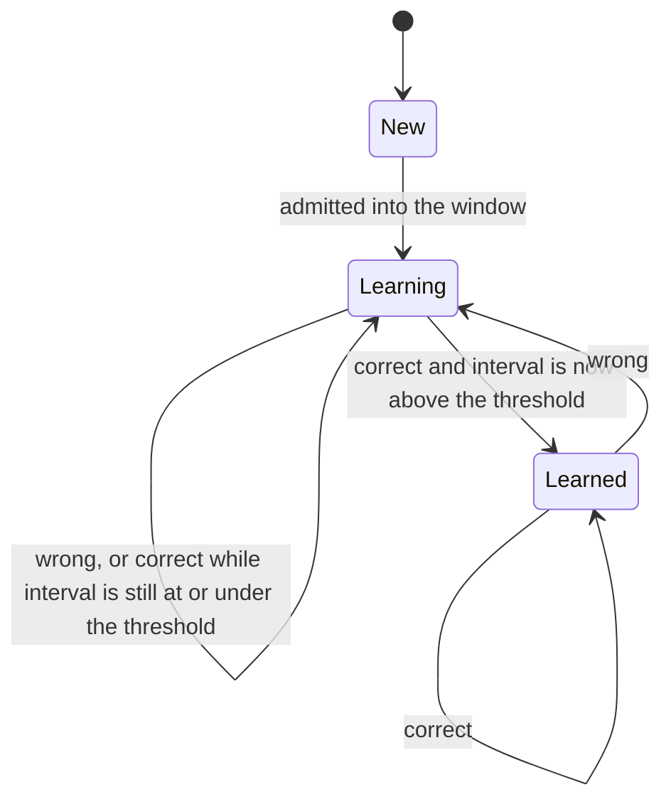

# Scheduling algorithm

This is the spec for how Rhythm Method Flashcards chooses the next card and updates it after Correct or Wrong. The app overview is in [ARCHITECTURE.md](ARCHITECTURE.md). Where they differ, this document wins. An early product sketch banned the last three cards from coming up again. This spec uses recency weights instead.

Two procedures share one card state. **Grade** updates a card after Wrong or Correct. **Select** chooses the next card. A study session is a loop of select, present, grade. The clock and the random draw are inputs, so the same steps can be replayed in tests.

## Terms

- A **topic** is a node in a tree. It has an optional parent topic. It may contain child topics and cards at the same time.
- A **card** belongs to exactly one topic.
- A **study scope** is either the whole library, or one topic plus all of its descendant topics. Every query below is limited to cards in the scope.
- A card is **new** when it has never been admitted: `learning` is false and `last_review` is null.
- A card is **learning** when `learning` is true. It occupies one seat in the window. This includes a card that was admitted but not graded yet, and a card that used to be learned and was then answered wrong.
- A card is **learned** when `learning` is false, `last_review` is set, and `interval > learned_threshold`. Learned is the state that priority 1 strengthens.
- A learned card is **due** at time `now` when `last_review + interval <= now`.
- The **overdue ratio** of a due card is `(now - last_review) / interval`. A card that is due this instant has ratio 1. A card that has waited twice its interval has ratio 2.

`learning` and "learned" are not two values of one enum. A wrong answer forces the learning seat even when the interval is still above the threshold, so a lapsed card is drilled again instead of waiting out its old due time.

## Parameters

User-tunable, stored once for the whole library. The settings screen exposes these five and no others.

| Name | Symbol | Default | Constraint |
| --- | --- | --- | --- |
| Correct factor | `C` | 1.5 | Must be greater than 1 |
| Wrong factor | `W_f` | 0.5 | Must satisfy `0 < W_f < 1` |
| Difficulty factor | `D_f` | 0.01 | Must satisfy `D_f >= 0` |
| Learning window size | `W` | 10 | Integer, at least 1 |
| Learned threshold | `T` | 1 hour | Must be greater than 0 |

Named constants. They are part of the algorithm, not settings, so a session is comparable from build to build.

| Name | Value | Role |
| --- | --- | --- |
| Initial interval `I_0` | 10 minutes | Interval assigned to a new card |
| Initial difficulty | 1.0 | Difficulty assigned to a new card |
| Minimum interval `I_min` | 1 minute | Floor after a shrink |
| Minimum growth `G_min` | 1.15 | Floor on the correct-answer multiplier |
| Difficulty cap | 10 | Ceiling on stored difficulty |

Intervals are stored as whole seconds. `I_0` is 600. `I_min` is 60. `T` defaults to 3600. Timestamps are UTC.

`I_min` is below `I_0` on purpose. During learning the interval is a progress meter, not a wait. A wrong answer has to be able to push that meter backward. If the floor were 10 minutes, the first wrong on a new card would not change it.

## Card fields

| Field | Type | Initial value |
| --- | --- | --- |
| `id` | stable id | assigned at creation |
| `topic_id` | topic id | chosen by the user |
| `front`, `back` | text | chosen by the user |
| `learning` | bool | false |
| `last_review` | timestamp or null | null |
| `interval` | seconds | `I_0` |
| `difficulty` | number | 1.0 |
| `created_at` | timestamp | creation time |

`created_at` is what "the next new card" means. Among new cards in scope, the oldest creation time wins. Ties break by `id` ascending.

## Grading

`grade(card, outcome, now)` snapshots the card first, so undo can restore it. Then:

On **correct**:

1. Difficulty does not change.
2. Let `growth = clamp(C / difficulty, min(C, G_min), C)`.
3. Because difficulty is at least 1, `C / difficulty` is at most `C`. The clamp never grows an interval faster than the user's correct factor. As difficulty rises, growth falls, and it stops falling at `G_min` (1.15) unless the user set `C` even lower, in which case growth stays at `C`.
4. `interval = advance(interval, growth)`.
5. If `interval > T`, set `learning` false. Otherwise set `learning` true.

On **wrong**:

1. `interval = shrink(interval, W_f)`.
2. `difficulty = min(10, difficulty + D_f)`.
3. Set `learning` true. Do this even when the new interval is still above `T`. A wrong answer never graduates a card.

Then set `last_review = now` for either outcome.

`advance` and `shrink`:

- Multiply the interval by the factor and round to the nearest second. Halves round away from zero, which is what Dart's `round` does on positive numbers.
- On a correct answer, if the factor is greater than 1 and rounding did not move the interval up, add one second. A correct answer cannot leave the meter stuck.
- After a shrink, if the result is below `I_min`, use `I_min`. A wrong answer may leave the interval unchanged once it is already on the floor.
- After either update, the stored interval is at least `I_min`.

With the defaults and difficulty 1, growth is exactly 1.5. A new card's meter runs:

| Consecutive corrects | Interval |
| --- | --- |
| 0 (just admitted) | 10 min |
| 1 | 15 min |
| 2 | 22.5 min |
| 3 | 33.75 min |
| 4 | 50.625 min |
| 5 | 75.9375 min, which is above 1 hour, so the card graduates |

Five corrects in a row graduate a fresh card. Four leave it at 50.6 minutes, still learning.

One wrong on a fresh card sets the interval to 5 minutes and difficulty to 1.01. Growth on the next correct is `1.5 / 1.01`, about 1.485. Counting in whole seconds, seven further corrects are required before the interval is above one hour. Difficulty never decreases. A card that has failed a lot keeps a slightly slower interval growth for the rest of its life. The effect is mild. At the cap of 10, raw growth would be `1.5 / 10 = 0.15`, but the `G_min` clamp holds growth at 1.15, so a correct answer still moves the card toward graduation.

Worked lapse. A learned card with a 4 hour interval is answered wrong. The interval becomes 2 hours, difficulty ticks up by 0.01, and `learning` becomes true even though 2 hours is still above the threshold. The card joins the drill. The next correct multiplies about 2 hours by about 1.5, the result is still above the threshold, and `learning` clears. One solid recall after a lapse puts it back on the long schedule. If the halved interval had landed at or below the threshold, the card would stay in the drill until correct answers pushed it back over.

## Selection

`select(scope, now, draw)` returns a face or "session clear". With the reverse drill off, each card is one face and the steps below are unchanged. [Reverse faces](#reverse-faces) says which faces are in the draw. Recency comes from that face's `last_review`, so it survives leaving the app. There is no separate "last three cards" list.

Weights are integers. `draw` returns an integer uniformly in `0 .. total - 1` for a caller-supplied total. Tests inject that integer. Production uses a uniform source. A weight of 0 is never chosen while the total is positive: walk candidates in order and take the first whose cumulative weight is greater than the draw.

1. **Due learned cards.** Take in-scope cards that are learned and due. If any exist, return the one with the greatest overdue ratio. Break ties by larger absolute lateness `(now - (last_review + interval))`, then by older `created_at`, then by `id` ascending. Do not consult the window or the new-card pile when this set is non-empty. Priority 1 is absolute. A card just graded is not due, because its interval is at least `I_min`.

2. **Weighted draw among learning cards and, when there is room, one new card.** This step runs only when step 1 returned nothing. Let `L` be the number of in-scope learning cards. Let `F` be the in-scope new cards in `created_at` then `id` order.

   Order the learning cards from most recently reviewed to least recently reviewed. A later `last_review` is more recent. A null `last_review` (admitted, never graded) is less recent than any timestamp. Break remaining ties by newer `created_at` as more recent, then by `id` descending. Assign each card a rank `r` along that order: the most recent gets `r = 0`, the next gets `r = 1`, and the least recent gets `r = L - 1`. When the window is full, that last rank is `W - 1`.

   The weight of a learning card is its `r`. Let `sum(R) = 0 + 1 + ... + (L - 1) = L * (L - 1) / 2`. The most recent card has weight 0. The least recent has weight `L - 1`, and when these are the only candidates its probability is `(L - 1) / sum(R) = 2 / L`. With a full window that is exactly `2 / W`.

   If `L < W` and `F` is non-empty, the next new card is one more candidate. Its weight is `|R| = L`, the number of learning cards. That is one rank past the least-recent learning card: it has never been reviewed, so it sits behind all of them. Its odds against the learning cards as a group are `|R| : sum(R)`, which is `L` to `L * (L - 1) / 2`.

   Draw one candidate with probability proportional to weight:

   - Total weight when a new card is included: `sum(R) + L = L * (L + 1) / 2`. Probability of admitting the new card: `2 / (L + 1)`. Probability of a learning card with rank `r`: `2 * r / (L * (L + 1))`.
   - Total weight when no new card is included: `sum(R)`. Probability of a learning card: `r / sum(R)`.
   - If `L` is 0, there are no ranks. Admit the first card of `F` if it exists.
   - If every weight is 0, which is a single learning card and no new card to admit, select that card anyway.

   On admission, set `learning` true on the first card of `F` and return it. The seat is taken at admission, before the grade, so quitting the app still counts the card against the window. `last_review` stays null until the grade.

   For the default window of 10, the chance of a new card when nothing learned is due:

   | Learning cards `L` | P(admit new) | P(least recent learning card) | P(most recent) |
   | --- | --- | --- | --- |
   | 0 | 1 | — | — |
   | 1 | 1 | 0 | 0 |
   | 2 | 2/3 | 1/3 | 0 |
   | 3 | 1/2 | 1/3 | 0 |
   | 5 | 1/3 | 4/15 | 0 |
   | 9 | 1/5 | 8/45 | 0 |
   | 10 | 0 | 1/5, which is 2/W | 0 |

3. **Otherwise the session is clear.** Nothing in scope is due, nothing is learning, and no new card was admitted. "Clear" means the scope has no due learned cards, no learning cards, and no new cards.

Consequences the tests should lock:

- The card graded most recently is not shown again on the next learning draw, as long as some other candidate has a positive weight. A card from two draws ago can appear, at a low weight. That replaces a hard ban on the last three presentations.
- Once `L = W`, the new card is not a candidate. New cards wait until a learning card graduates and frees a seat. After one graduation, `L = W - 1` and the admission probability is `2 / W`.
- While one learning card exists and a new card is waiting, the next draw always admits that new card. A lone card is not drilled until a second card has joined, or until no new card remains. With a window of 1 this does not arise, because the seat is full after the first admission and the single card is then repeated.

The window is counted inside the current scope, not across the whole library. Seats are faces, so a card whose forward face has lapsed and whose reverse face is learning holds two. Studying two topics separately gives each pile its own seats. A face marked learning still occupies a seat in every scope that contains it. Studying a parent topic counts learning faces in that topic and its descendants together. Studying all topics counts every learning face in the library. If that count is already at `W`, no further new face is admitted until one graduates.

## Reverse faces

A topic may drill a card back to front after the forward face is learned. The switch is stored on that topic. It is off until the user turns it on, and it does not pass to subtopics. A card follows the switch on its own topic, including when the session scope is a parent topic or the whole library.

The reverse face has its own `learning`, `last_review`, `interval`, and `difficulty`. A null queue timestamp means the face does not exist. Creating one sets `learning` false, `last_review` null, `interval` to `I_0`, and `difficulty` to 1.0. It does not copy the forward face. A grade on one face does not change the other.

The face is created only when the switch is on and the card does not have one yet:

- The forward face just graduated. This correct answer cleared `learning` because the interval is now strictly above `T`.
- The user turns the switch on, and the forward face is already learned. Every such card in that topic gains a face. Cards known longest, measured by the oldest forward `last_review`, are placed ahead of cards learned more recently.

Turning the switch off stops creating faces and stops selecting them. They leave the window count. Their stored state remains. Turning the switch on again resumes them, and backfills learned cards that still have no face.

Queue order among waiting reverses puts the newest graduation at the front. Timestamps are whole UTC seconds, because that is the resolution SQLite stores:

- A face created by a graduation is strictly after every queue time already stored, so it is the head of the line.
- A backfill sits behind reverses that were already queued. Inside the backfill, the longest-known card is ahead.
- A later graduation still cuts in front of that backfill. A run of graduations keeps putting the newest reverse at the front. Ordinary new cards wait behind every waiting reverse.

Selection is the same three steps, applied to faces that are in play. The forward face is always in play. The reverse face is in play only when the card's own topic has the switch on and the queue timestamp is set.

1. Due learned faces, ordered as due learned cards are ordered. When the ratio, the lateness, `created_at`, and `id` all tie, the forward face comes first.
2. `L` is the number of in-play learning faces. One card can hold two seats. The new face that may join the draw is the waiting reverse at the head of the queue, or, when none is waiting, the oldest never-started card. The weights do not change.
3. The session is clear when no in-play face is due, learning, or new.

A full window admits nobody, including a waiting reverse. A waiting reverse does not skip the window and does not outrank a due learned face. While `L` is 0 or 1 and a new face is waiting, the next draw admits that face.

In study, a reverse prompt is the card's back and the answer is the card's front. The border still means prompt versus answer. The card shows a Reverse label. Flip works the same way. The review row records the direction. Undo writes the pre-grade snapshot of the whole card back and shows the graded face on the answer side. Undo of the graduation that created a reverse removes that face, because the snapshot was taken before it existed. Undo does not un-admit.

Status numbers count in-play faces. A waiting reverse counts as a new card. The sentence stays in the form in the next section. One card can contribute to two of those counts.

## What the interval means

Before graduation the interval is not a delay. Learning cards are eligible on every draw, regardless of `last_review + interval`. The interval only records how close the card is to graduating, and it only becomes a real wait after `learning` is cleared. After graduation the card is hidden until `last_review + interval`.

That split is the slow start. A dump of hundreds of new cards does not become hundreds of reviews. At most `W` of them are in play. They are mixed with whatever learned cards are due, and a new one can enter only while a seat is free. Once the window is full, new cards wait for a graduation.

Nothing in the rules ends a session while learning cards remain. The user stops when they want. The study screen should say so in plain numbers, for example "Learning 10 of 10. 490 new cards are waiting until one of these graduates. 3 learned cards are due." When the session is clear, say that nothing is due.

## Study session and undo

A session loops: select, show the prompt, and let the user flip as many times as they want before grading. The first completed reveal of the answer unlocks Wrong and Correct. Those buttons stay available if the card is turned back to the prompt. Swipes grade only while the answer is showing, and only after that first reveal. A turn that is still moving does not grade. Edit opens the card editor and does not change schedule fields. Leaving the session and coming back uses the persisted `learning` flags, intervals, difficulties, and `last_review` times. Those timestamps are the recency ranks, so the weighted draw continues where it left off.

Every grade appends a review row: card id, time, outcome, the face that was graded, and the before and after values of that face's interval, difficulty, and learning flag. Undo pops the latest grade in this session, writes the before-values back onto the card, deletes that review row, and shows that same face again on the answer side, ready to grade, without replaying the turn. Undo does not un-admit a card and does not undo Edit. The undo stack is the session's grades, newest first, so more than one undo works.

## Invariants

Each of these is a unit test with a fake clock and a scripted draw. Where a probability is stated, every residue in `0 .. total - 1` is checked, not a random sample.

1. A wrong grade sets `learning` true even when the resulting interval is still above `T`.
2. A correct grade sets `learning` false only when the resulting interval is strictly above `T`. It sets `learning` true otherwise.
3. A correct grade does not change difficulty. A wrong grade adds exactly `D_f`, and never past the cap of 10.
4. A correct grade never decreases the interval. A grade never stores an interval below `I_min`.
5. Defaults, difficulty 1, start at 10 minutes: after five corrects the interval is above 1 hour and `learning` is false. After four it is not.
6. One wrong on a fresh card yields a 5 minute interval and difficulty 1.01. Seven further corrects then graduate it, and six do not.
7. No new card is admitted while any in-scope learned card is due.
8. No new card is admitted while the in-scope learning count equals `W`.
9. With nothing due, `L < W`, and a new card waiting, the share of draws that admit it is `2 / (L + 1)`, and admitted cards follow `created_at`. With `L = 0` or `L = 1`, that share is 1.
10. With a full window, the most recently reviewed learning card has probability 0 and the least recently reviewed has probability `2 / W`. Ranks are `0, 1, ..., L - 1` in most-recent-first order.
11. With one learning card and no new card, selection returns that card. With one learning card and a new card waiting, selection admits the new card.
12. The most-overdue ratio wins over a larger absolute lateness on a longer interval.
13. A card outside the scope is never returned. A child topic's cards are in the parent scope. They are not in a sibling scope.
14. Undo restores interval, difficulty, `learning`, and `last_review` to the pre-grade snapshot.
15. Admitting a card sets `learning` true before the grade. A second select does not admit it again.
16. A grade on one face does not change the other face's interval, difficulty, learning flag, or last review. A new reverse face starts at `I_0` and difficulty 1.0.
17. Among new faces, every waiting reverse comes before every never-started card. A graduation's reverse is the head of that line. A backfill is behind reverses already queued, and within the backfill the oldest forward `last_review` is ahead. A later graduation cuts in front of the backfill.
18. With the switch off, reverse faces are not selected and do not count toward the window. A due learned face outranks a waiting reverse. A full window admits no reverse. Two learning faces on one card occupy two seats. A card uses the switch on its own topic.

## Decisions

**Difficulty slows growth, and growth has a floor.** `growth = clamp(C / difficulty, min(C, G_min), C)`. Reading difficulty as a multiplier on the correct factor is also compatible with `interval * C * difficulty`, which would lengthen the interval faster on cards the user has failed. That fights priority 2, because weak cards should stay in play. Division matches the name "difficulty": a hard card's interval grows more slowly. Uncapped division is unsafe. After enough wrongs, growth would drop to 1 or below and the card could never graduate. `G_min` at 1.15 prevents that. Difficulty still only changes on wrong answers, and it never decays.

**The learning interval is not a wait.** The selection steps never say that a learning card must be due. Treating the interval as a wait would turn the window into ordinary spaced repetition and remove the drill that makes a small set stick. The interval becomes a wait only after graduation.

**A lapse returns to the drill even if the interval is still long.** Any wrong reply sets a card into learning regardless of its time interval. The seat is released only by a later correct grade whose resulting interval is above `T`.

**Learning cards are chosen by recency weight, and a new card joins that same draw.** Rank the learning cards most-recent-first with weights `0, 1, ..., L - 1`. The most recent weight is 0, so it is skipped whenever anything else can be shown. The least recent weight is `L - 1`, which is probability `2 / L` when no new card is in the draw, and exactly `2 / W` when the window is full. While `L < W`, the next new card has weight `|R| = L`, so the odds of admitting it rather than drilling are `L` to `sum(R)`. Its probability is `2 / (L + 1)`. Treating those odds as an unnormalized probability `|R| / sum(R) = 2 / (L - 1)` is greater than 1 whenever fewer than three cards are learning, so the weights are normalized by `sum(R) + |R|`. The next new card is the oldest `created_at`. Giving the least-recent card weight `W - 1` even when the window is not full would need a second rule for the ranks in between, and a sparse window would then ignore every card but the oldest. Ranks stay `0` through `L - 1`.

**Due learned cards are ordered by overdue ratio.** The product overview does not define an order among due cards. Ratio prefers cards that are late relative to their own interval, which is what "strengthen what you already learned" wants when a short card and a long card are both due.

**The window is per study scope.** A global window of 10 would let one large topic occupy every seat and block every other topic. Counting seats inside the scope the user chose gives each subject its own slow start. The cost is that studying topics separately can put more than 10 cards into `learning` across the library. Studying everything then sees that larger set and admits nobody new until the count is back under `W`.

**Extra bounds are constants, not settings.** The tunable set is fixed at five. `I_0`, `I_min`, `G_min`, and the difficulty cap stay in code so the settings screen stays that list.
